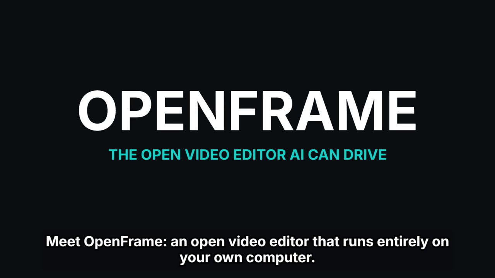

# OpenFrame

OpenFrame began as an experiment: **autonomously develop a fully open video
editor using Claude Code and Codex**. The project's implementation was
developed using AI coding agents, with a human owner setting the direction,
trying the product, and deciding what should ship. The goal is a capable
editor that anyone can use, study, improve, and redistribute.

Development is **desktop first**: Tauri v2 + Rust, with a shared React and
TypeScript editing engine. A secondary web app runs on the user's own
device with the capabilities its browser supports. The ambition combines
fast, approachable editing with deep timeline, color, audio, and automation
tools. This remains an experiment in active development; the feature map
and roadmap distinguish implemented work from plans.

## Watch: an AI agent edited this video

[](docs/media/openframe-promo.mp4)

**[▶ Watch the 53-second promo](docs/media/openframe-promo.mp4)** (GitHub plays it in its file viewer).

Claude made it end to end through OpenFrame's own MCP tools. It wrote the
script and voiced it on this computer (`add_voiceover`: Kokoro speech with
captions timed to it), recorded OpenFrame's web build in a headless browser
for the footage, cut the picture to the voice, pushed in on each panel
(`frame_region`), added the titles, transitions and a music bed ducked
under the voice, and exported it (`export_video`). Nobody touched the
timeline by hand. What it took, and what it taught the editor, is in
[History](docs/History.md) (2026-10-17).

## Repository and current status

Repository: [gAlexander77/openframe](https://github.com/gAlexander77/openframe)
(formerly `video-editor`; GitHub redirects the old URL).

The project was renamed **OpenFrame** on 2026-10-17: the app, its window,
binary (`openframe`), packages and repository. The app's data folder keeps
its old identifier so every saved project stays where it is; see
[the rename notes](docs/Renaming.md).

The repository is being kept private while it is prepared for an open-source
release. Access currently requires permission; this README does not announce
a public release, hosted service, or downloadable installer.

## Run from source

With repository access, clone the current URL:

```sh
git clone https://github.com/gAlexander77/openframe.git
cd openframe
npm ci
npm run tauri dev
```

Desktop development needs Node.js/npm, Rust, and Tauri's platform-specific
build prerequisites. FFmpeg and ffprobe on `PATH` enable the desktop's
broader media-format support. The optional `just` task runner provides the
combined quality gates.

```sh
npm run dev          # secondary web app at http://localhost:1420
just check           # frontend build/tests and Rust checks
npm run tauri build  # build this platform's desktop release
```

See the [user guide](docs/User%20guide.md) for a first editing session,
project storage, exports, and platform limits.

## What the documentation is for

Documentation is part of the experiment's working memory. It helps users
understand the editor, contributors understand the implementation, and AI
agents resume work with the decisions, evidence, and lessons from earlier
sessions. It explains why a choice was made, how it was checked, and what
remains uncertain.

- [Documentation index](docs/Index.md): the map of guides, architecture,
  research, decisions, and history.
- [Features](docs/Features.md): what is implemented today.
- [Roadmap](docs/Roadmap.md): pending and proposed work.
- [AI development and documentation](docs/AI%20development.md): how the
  experiment works and how agents use these records.
- [Architecture](docs/Architecture.md) and
  [project format](docs/Project%20format.md): how the editor works and how
  projects are represented.
- [Automation](docs/Automation.md): headless rendering, MCP, and the AI assistant.

## Contribute

Bug reports, usability feedback, documentation, accessibility work, tests,
and code contributions are welcome. Start with
[CONTRIBUTING.md](CONTRIBUTING.md). During private development, contributors
need repository access from the owner. AI-assisted contributions are welcome
when their author can explain and validate the result.

Coding agents should begin with [AGENTS.md](AGENTS.md), the shared
[CLAUDE.md](CLAUDE.md) manual, and the
[next-agent handoff](docs/Next%20agent%20handoff.md).

## License

Copyright (C) 2026 Alex Martinez and OpenFrame contributors.

OpenFrame's original project code and documentation are licensed under the
**GNU General Public License, version 3 only** (`GPL-3.0-only`). You may use,
modify, and redistribute covered work under its terms, including for
commercial purposes. Distributed modified versions must preserve the GPL's
freedoms and satisfy its source-code requirements. There is no warranty.
The complete terms are in [LICENSE](LICENSE).

Third-party libraries, models, fonts, and media retain their own licenses.
Using the editor does not automatically place your videos under the GPL.
See [release preparation](docs/Release%20preparation.md) for the dependency
inventory and the remaining distribution work.
