# OpenFrame

**An open, desktop-first video editor that an AI agent can drive, built in
a week by AI coding agents.** CapCut's ease, with Premiere and VEGAS depth
underneath. Everything runs on your own computer.

[](https://galexander77.github.io/openframe/#film)

*The launch film was cut, scored and narrated by an AI agent inside
OpenFrame, through its own MCP tools.*
**[▶ Watch it with sound](https://galexander77.github.io/openframe/#film)**
(68 s, with captions) or [download the MP4](openframe-website/public/media/launch-film.mp4).

[Website](https://galexander77.github.io/openframe/) ·
[The experiment](https://galexander77.github.io/openframe/experiment/) ·
[User guide](docs/User%20guide.md) ·
[Features](docs/Features.md) ·
[Documentation](docs/Index.md)

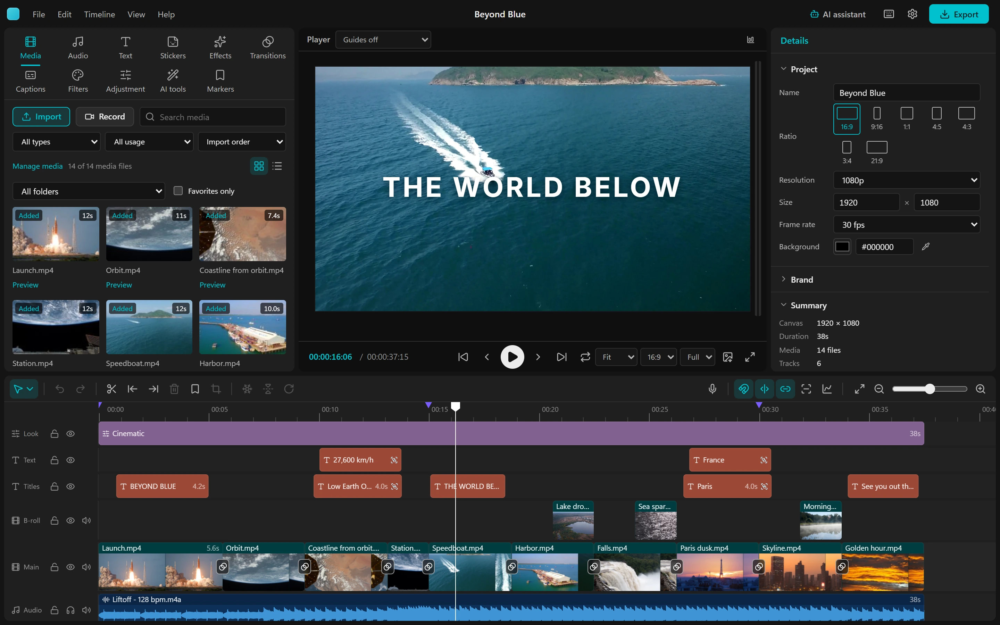

## The experiment

On 2026-10-13 the owner asked for "a modern CapCut" with VEGAS Pro and
Premiere depth, desktop and web, local AI features, and automation that AI
agents can drive. Then they stepped back.

**AI coding agents did the work.** Claude Code and Codex:
- researched CapCut, Premiere, Resolve and VEGAS before building each part;
- wrote the code, the tests and the documentation;
- drove the running app in a headless browser to check their own changes;
- reviewed each other's work.

**The owner held the direction.** They chose desktop first, local-only
compute, GPL-3.0 and the name. They tried each build and said what felt
wrong, and decided what shipped and when.

| Day | What happened |
|---|---|
| Oct 13 | Research, then the core, test-first: frame-exact edits, a command registry that agents can call, the engine and the four-panel editor. |
| Oct 14 | Parallel agents in their own worktrees: the desktop platform, export, local AI tools. |
| Oct 14–16 | A Codex pass of 32 commits, reviewed by Claude Code. Then the timeline, masks and crop, compound clips, background removal, and a CapCut parity pass. |
| Oct 17 | An agent edited a whole promo over MCP for the first time. The app became **OpenFrame**, and the repository opened. |
| Oct 18 | The tools a professional edit needs, a second film, and the website. |
| Oct 19 | A third film, voiced and scored inside the app. Four agents swept the UI at every window size, and an agent's changes now show its mark. |

**Seven days in:**
- about 400 commits;
- about 55,000 lines of TypeScript and 3,400 of Rust;
- 1,172 unit tests and 168 Playwright drives of the real app;
- 156 MCP tools;
- 93 decision records and 17 research notes.

Everything an agent learned is written down: why each choice was made, how
it was checked, and what it got wrong. The next session reads it before
touching anything. [How the experiment works](docs/AI%20development.md),
and [every round, in order](docs/History.md).

## An AI agent edits with you, live

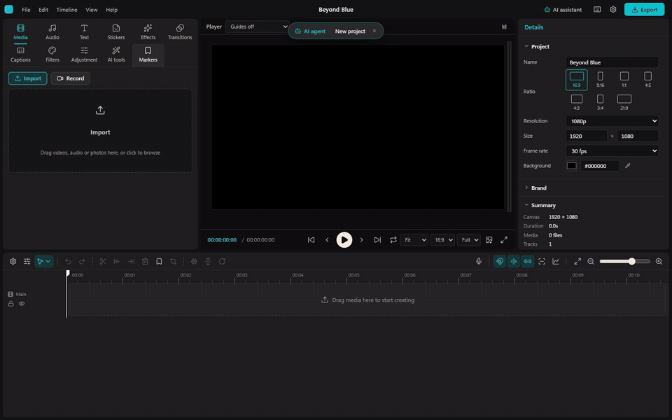

Turn on **Allow AI agents** and Claude Code, Codex, or any MCP client can
open your project and edit it while you watch. Each change is named at the
top of the window, marked **AI agent** with the robot icon. Every change is
one undo away.

The agent works through the same 156 tools for everything:
- **Building:** import, cut, title, color, keyframes, sound and voice.
- **Checking:** contact sheets and frame previews to look at its own work,
  and a design check for sizes, contrast, safe areas and the TikTok and
  Reels zones.
- **Delivering:** exports and every vertical or square version.

A built-in **AI assistant** runs a local model the same way.

**How the launch film was made.** Claude wrote the script, then read it
with the app's on-device voice; Whisper listened back, and three lines were
retaken. It composed the score with `generate_music`, timed the drops to
the cuts, and ducked the music under the voice. It built every title,
window and glow with the MCP tools and checked it with `check_project`.
The export came out at -14 LUFS, with a 9:16 cut. Nobody touched the
timeline by hand.
[The making of, limits included](docs/research/Launch%20film%203%20through%20MCP%202026-10-19.md).

## What it does

<table>
<tr>
<td width="50%">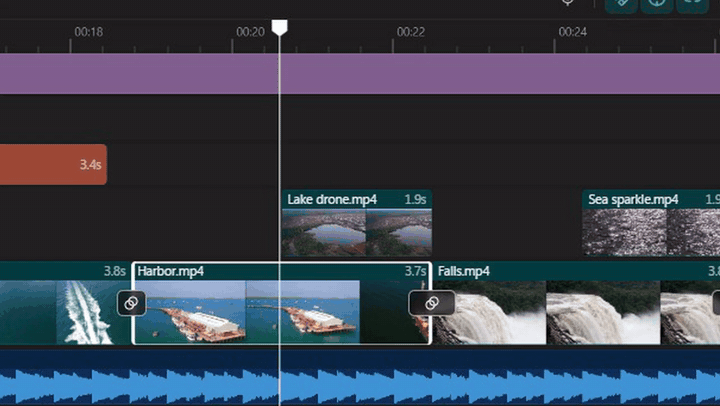<br><b>Edit fast.</b> A magnetic timeline with ripple, roll, slip and slide, linked audio, compound clips and frame-exact trims.</td>
<td width="50%">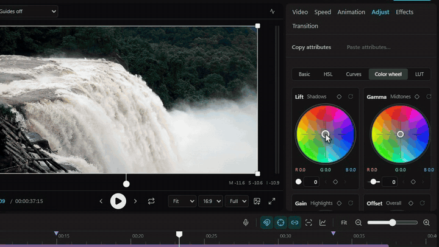<br><b>Real color.</b> Basic, HSL, curves, color wheels, LUTs, scopes and adjustment layers.</td>
</tr>
<tr>
<td>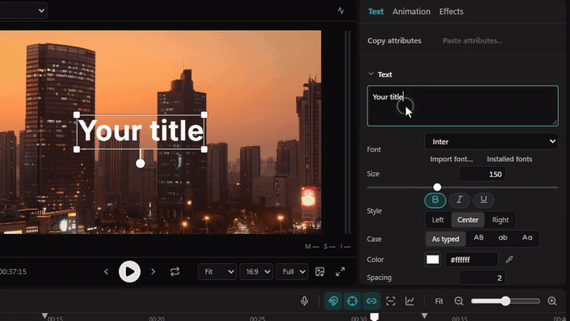<br><b>Titles that move.</b> Styled words in one title, per-word and per-letter animations, templates, brand kits.</td>
<td>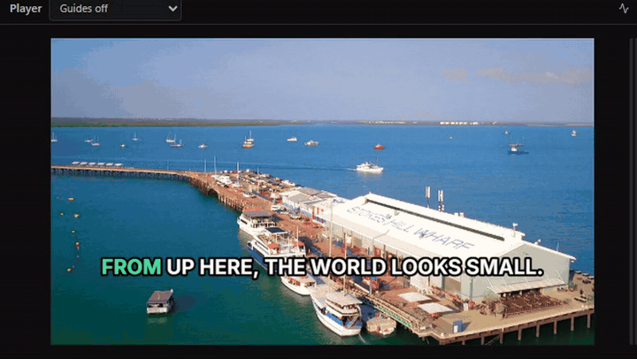<br><b>Captions on your machine.</b> Whisper transcribes locally, with word-by-word highlight looks.</td>
</tr>
<tr>
<td>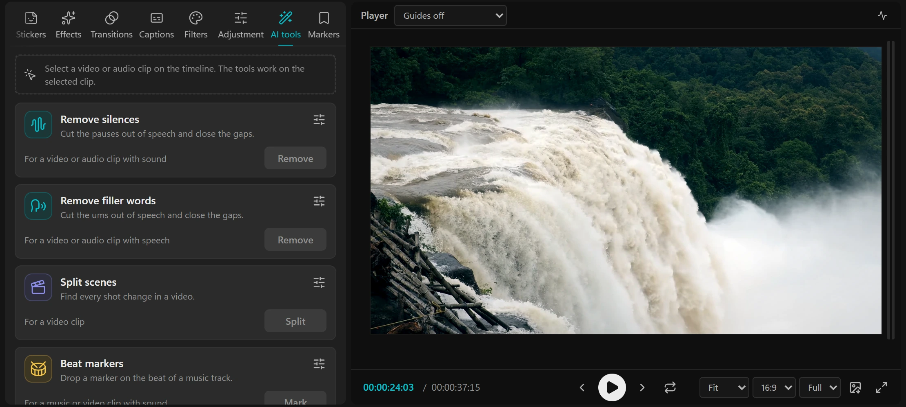<br><b>Local AI tools.</b> Remove silences and filler words, split scenes, beats, background removal, noise reduction, voiceovers, music.</td>
<td>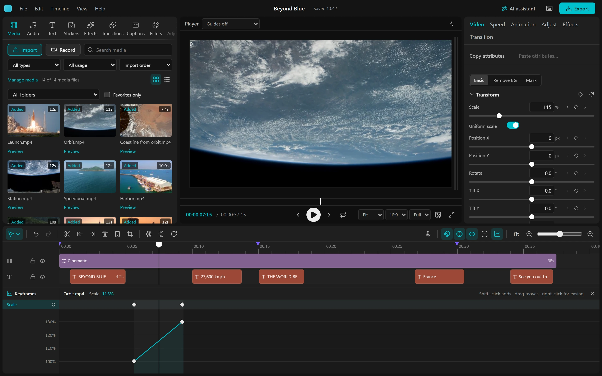<br><b>Keyframes and motion.</b> A graph editor with easing, motion paths, tracking and speed curves.</td>
</tr>
<tr>
<td>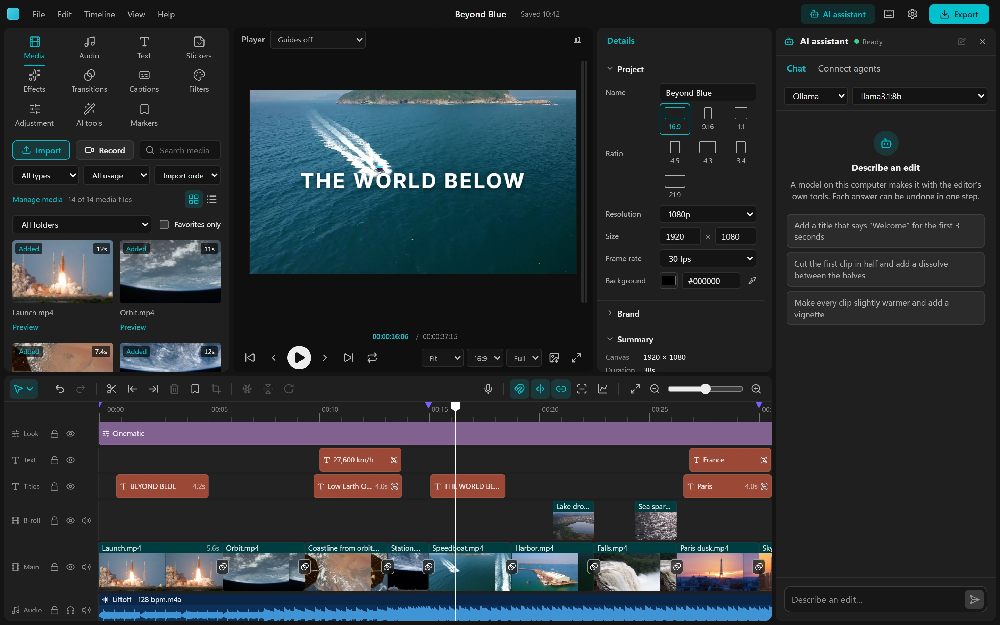<br><b>An assistant beside the timeline.</b> Describe an edit; a model on your computer makes it with the editor's own tools.</td>
<td>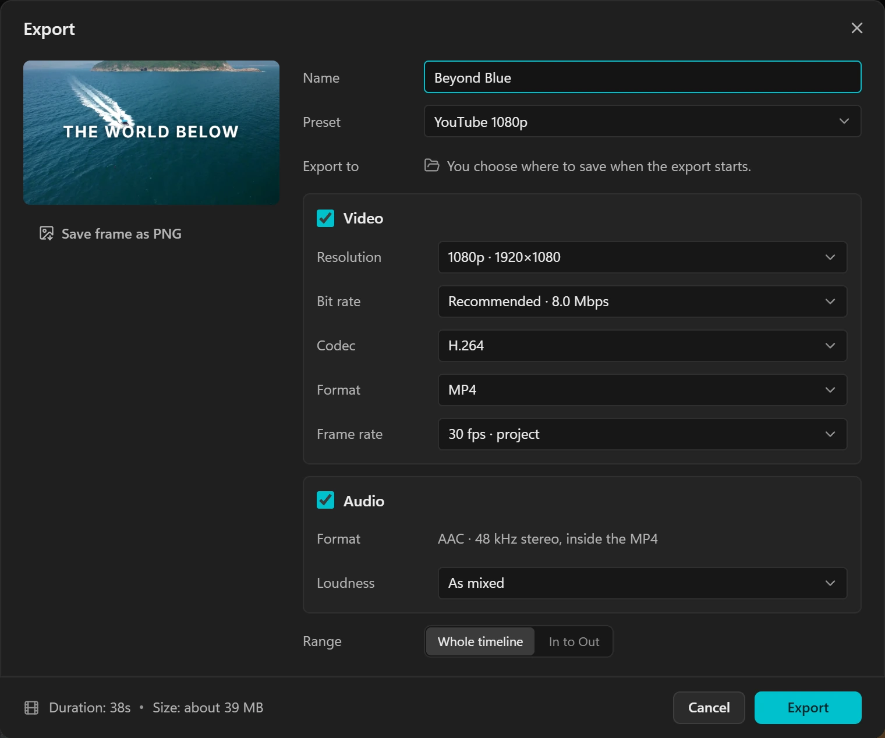<br><b>Export for every screen.</b> H.264, HEVC, AV1 or VP9 in MP4, MOV, WebM or MKV, loudness to -14 LUFS, captions burned in or beside.</td>
</tr>
</table>

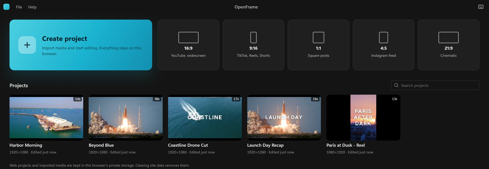

The full list, implemented and planned, is in [Features](docs/Features.md)
and the [Roadmap](docs/Roadmap.md).

## Your footage stays on your computer

There is no server of ours. Media is decoded, edited and exported on your
device, and the AI models (speech, captions, background removal, the
assistant) run locally. Agents connect over a local MCP endpoint that you
turn on. A secondary web app runs in the browser with what the browser
supports, still on your device. [Privacy](https://galexander77.github.io/openframe/privacy/).

## Run from source

There is no packaged release yet. With Node.js, Rust and
[Tauri's prerequisites](https://tauri.app/start/prerequisites/):

```sh
git clone https://github.com/gAlexander77/openframe.git
cd openframe/openframe-application
npm ci
npm run tauri dev
```

FFmpeg and ffprobe on `PATH` widen the desktop's media formats. From
`openframe-application/`:

```sh
npm run dev          # the web app at http://localhost:1420
just check           # type checks, tests, and the Rust checks
npm run tauri build  # a desktop build for this platform
```

**Connect an agent:** open the AI assistant's **Connect agents** tab, turn
on **Allow AI agents**, and click **Add to Claude Code** or **Add to
Codex** ([Automation](docs/Automation.md) has the details and the headless
`openframe` command line).

The repository holds the editor (`openframe-application/`), the website
(`openframe-website/`, deployed to GitHub Pages) and the documentation both
share (`docs/`). The [user guide](docs/User%20guide.md) walks through a
first edit.

## Documentation

The documentation is the experiment's working memory: it serves users,
contributors and the next agent alike.

- [Index](docs/Index.md): the map of guides, architecture, research,
  decisions and history.
- [Architecture](docs/Architecture.md) and the
  [project format](docs/Project%20format.md).
- [Automation](docs/Automation.md) and the [MCP tools](docs/MCP%20tools.md).
- [Decisions](docs/decisions/), [research](docs/research/) and
  [History](docs/History.md).

## Contribute

Bug reports, feedback on how it feels to use, documentation, accessibility,
tests and code are all welcome. Start with [CONTRIBUTING.md](CONTRIBUTING.md).
AI-assisted contributions are welcome when their author can explain and
check the result. Coding agents begin with [AGENTS.md](AGENTS.md),
[CLAUDE.md](CLAUDE.md) and the [handoff](docs/Next%20agent%20handoff.md).

The app was renamed OpenFrame on 2026-10-17 (it was `video-editor`; GitHub
redirects the old URL). Its data folder keeps the old identifier so saved
projects stay put: [the rename notes](docs/Renaming.md).

## License

Copyright (C) 2026 The OpenFrame contributors.

OpenFrame's code and documentation are licensed under the **GNU General
Public License, version 3 only** (`GPL-3.0-only`). You may use, modify and
redistribute it under its terms, including commercially. Distributed
modified versions must keep the GPL's freedoms and meet its source-code
requirements. There is no warranty; the full terms are in
[LICENSE](LICENSE).

Third-party libraries, models, fonts and media keep their own licenses, and
the videos you make are yours: using the editor does not place them under
the GPL. The demo footage is CC0 and public domain
([credits](https://galexander77.github.io/openframe/credits/)), and the
dependency inventory is in [release preparation](docs/Release%20preparation.md).
