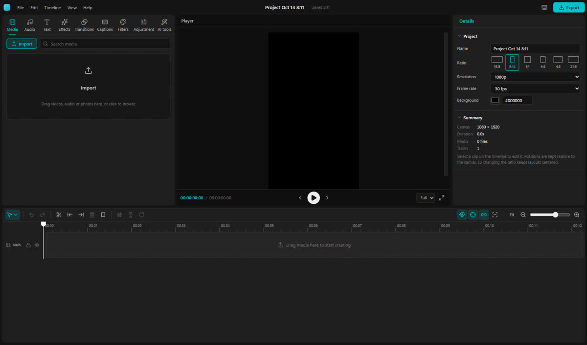
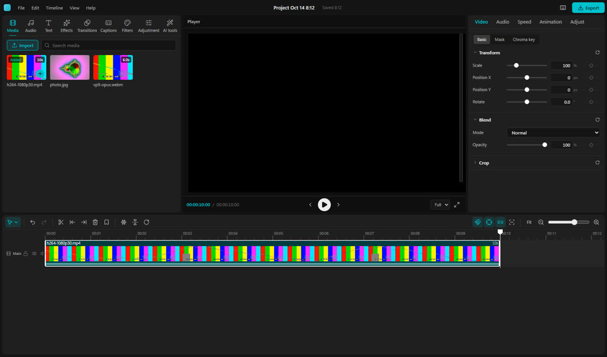
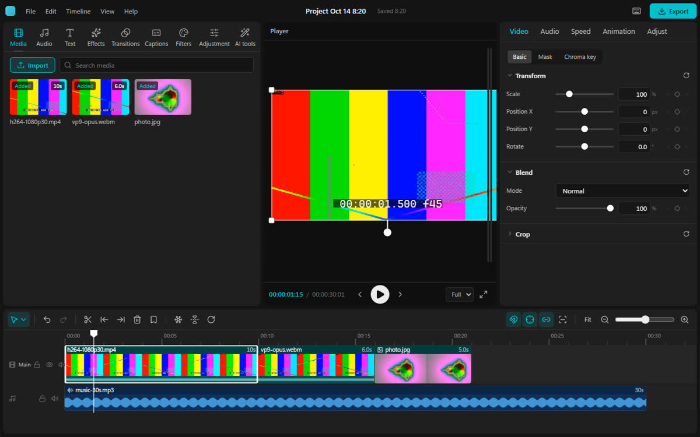
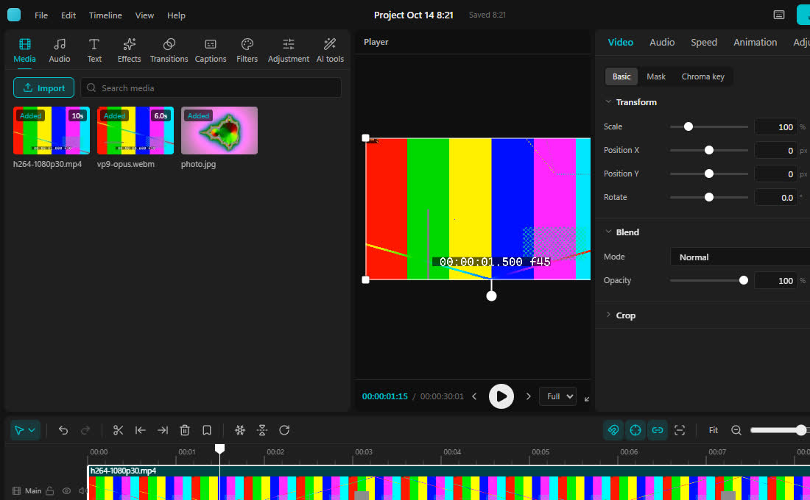
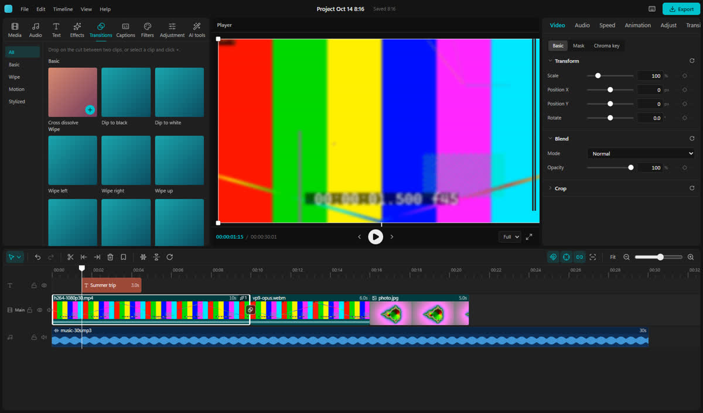
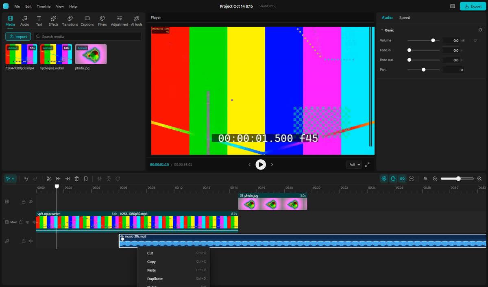
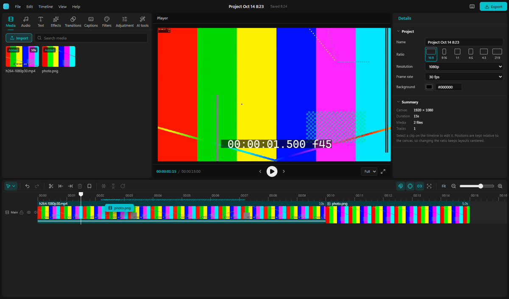
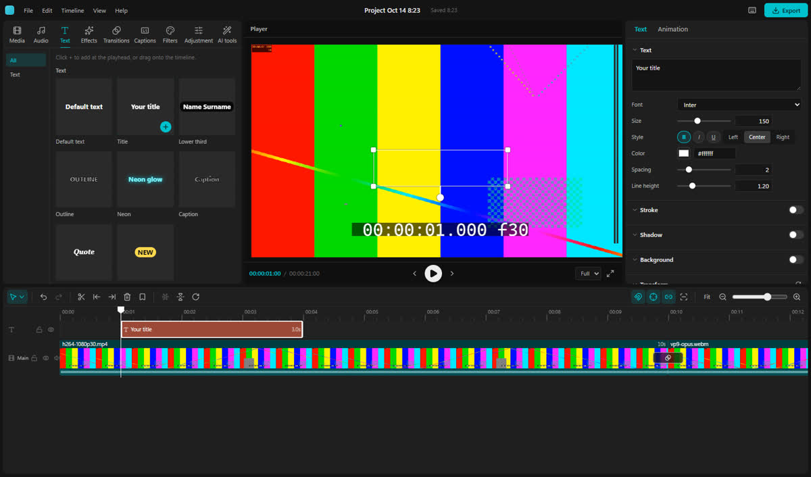
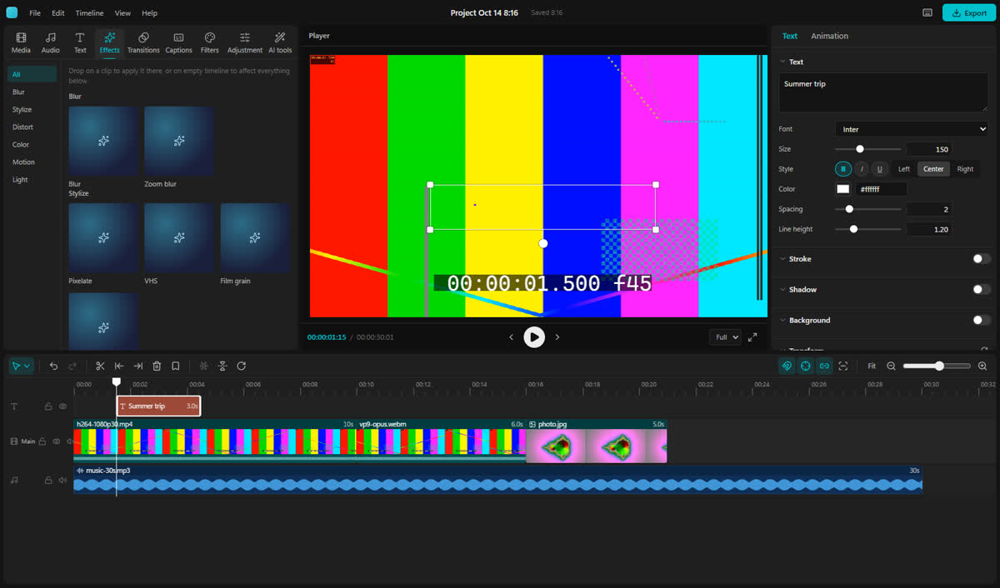

# UX audit 2026-10-14

A first-time CapCut user's walk through the current product: what they trip
over, what to fix, and what to keep. Each finding has an id (UX-NN) that the
fix commits name. Small, isolated fixes landed on the `ux-audit` branch;
everything bigger is a recommendation with file pointers.

## Summary

The core loop works and already feels like CapCut: presets named for where
the video goes, autosave with a stamp, a magnetic main track that reorders
with a drag, trim readouts in timecode, every keymap action doing what its
label says, live inspector edits with CapCut's keyframe cluster, local
captions with honest download sizes, and a searchable shortcuts panel.

What a real user hits first is different: **Export does nothing**, a **9:16
project silently turns 16:9** when the first clip is landscape, the
**picture is cropped and covered by the meter** in the viewer, the inspector
and Export button fall **off the window at the app's own minimum size**,
and merely **tabbing through the inspector adds keyframes** and undo steps.
Several smaller habits break flow: touching a slider steals Space and J/K/L,
the viewer goes black whenever playback ends, the right-click menu runs off
the screen, menus cannot be opened from the keyboard, and editor shortcuts
keep playing the closed project's sound on the home screen.

This branch fixed or eased 23 of the 38 findings, everything above except
Export itself and the 9:16 canvas; the rest need feature work and are
ordered under [Needs feature work](#needs-feature-work-in-order).

## Method and boundaries

- Baseline: `7a53c5e` on `main`; web build served by Vite on :1500.
- Driven with playwright-core and the system Edge (headless), viewports
  1600×940 (default window), 1280×800, 1920×1080, 1100×680 (the desktop
  app's minimum) and 1024×680, plus `prefers-reduced-motion: reduce`.
- Real pointer and keyboard input for every journey; `window.videoEditor`
  only to set up states and read results. Fixtures from
  `scripts/make-fixtures.mjs`, imported through the file picker, by
  synthetic OS drops (real `File` objects in a `DataTransfer`) and by URL.
- Auto captions: the model download was intercepted (held 4 s, then
  aborted) to see the progress and failure states without downloading.
- Not covered: the desktop app over WebView2 (native file drops, window
  chrome, the media protocol), export (not built yet), GPU frame pacing
  (headless numbers would not mean anything), screen readers.
- Raw captures (~10 MB, ignored) are in
  `scripts/ui-review/shots/2026-10-14/*.png` after a run; the cited key
  shots are committed there as `key-*.jpg`. Drive scripts lived in the
  ignored `scratch/` folder.

## Coverage

| Journey | Result |
|---|---|
| Home → 9:16 preset → editor | Works; preset later overridden (UX-02) |
| Import by picker (4 files), OS drop on library and timeline | Works; audio hidden from Media (UX-16) |
| Unsupported files (ProRes on web, a .txt) | Refused with a named toast (UX-23 copy) |
| Add to timeline: double-click, +, drag, drop above main | Drop above main misplaces (UX-12, UX-13) |
| Trim, move/reorder, move up to a new track, blade, marquee, right-click | Works; linkage moves music (UX-14), menu off-screen (UX-10) |
| Text preset, image overlay, transition, effect (drag), filter (+) | Works; title invisible on add (UX-15), Transition tab hidden (UX-09) |
| Inspector transform, on-canvas move/scale/rotate, keyframes | Works; phantom edits (UX-05), slider steals keys (UX-06) |
| Captions: empty state, progress, tab switch, failure, SRT import, caption list | Works; error and state gaps (UX-22) |
| Every chord in `src/lib/keymap.ts` | All do what they say except `importMedia` and `export` (UX-01) |
| Undo/redo, shortcuts panel, back home, reload, reopen, delete twice | Works; home shortcuts (UX-07) |
| Window sizes, reduced motion, tab order, tooltips, contrast | UX-03, UX-04, UX-11, UX-19, UX-20, UX-25 |

## Findings

P0 blocks a core journey. P1 is friction a first-time user will hit and
notice. P2 is polish. Status says whether this branch fixed it.

### P0 — blockers

#### UX-01 Export, and the Import media shortcut, do nothing · P0

- **Steps:** click the cyan Export button, or File › Export, or the `export`
  chord; File › Import media or the `importMedia` chord. Nothing happens —
  no dialog, no toast, no console error.
- **Why:** Export is the primary button on screen and the end of every
  journey; a silent primary action reads as a crash. The shortcuts panel
  advertises both chords.
- **CapCut / Premiere:** Export opens the export dialog (CapCut §6.1);
  import opens the OS picker.
- **Fix:** wire `importMedia` to `pickAndImport` (`src/state/media.ts`);
  until the export round lands, `run()` in `src/state/actions.ts` answers
  any action nobody provides with a toast instead of silence. The export
  dialog itself is in flight ([[Roadmap]]).
- **Status:** fixed. Import media on this branch; Export by the export
  round, which landed on main before this audit was merged (the "isn't
  available yet" answer remains for any future unprovided action).

#### UX-02 A 9:16 project turns 16:9 when the first clip is landscape · P0

- **Steps:** Home › 9:16 (TikTok, Reels, Shorts) → import
  `h264-1080p30.mp4` → add it. The canvas becomes 1920×1080; the Details
  ratio flips to 16:9 with no notice.
- **Why:** the user made an explicit choice for a vertical video; the first
  action of the project undoes it. Most CapCut users publish vertical.
- **CapCut:** "Create project" starts at ratio *Original* (adapts to the
  first clip); once the user picks a ratio, clips are fitted into it and
  the letterbox is filled by Canvas (§3.1).
- **Fix (feature work):** record that the canvas was chosen
  (`canvasLocked` or `ratio: "original" | "fixed"` in the project,
  [[Project format]]), set it from Home presets and from the Details ratio
  buttons, and have `adoptSettings` (`src/state/media.ts`) skip a fixed
  canvas. Pair with UX-17 so the bars are not black.
- **Shot:** the 9:16 project before the first clip —
  
  — and the same project after it, 16:9:
  
- **Status:** open.

### P1 — friction

#### UX-03 The viewer crops the picture and the meter covers its right edge · P1

- **Steps:** any 16:9 project at 1280×800: the right of the frame is cut
  off; at 1600×940 the peak meter sits on the frame's right edge; at
  1920×1080 the bottom (and the rotate knob) is clipped.
- **Why:** the viewer is the one place the user judges their edit; text at
  the edges looks missing.
- **CapCut:** the canvas is always fully inside the player, letterboxed.
- **Fix:** `src/components/Player.tsx` fitted the frame to the stage's
  border box (including its 14/36 px padding); fit to the content box and
  give the meter its own gutter (`player.css`).
- **Shot:** 
- **Status:** fixed on this branch; the frame-accuracy drive still reads
  66 of 66 frames exactly.

#### UX-04 At the minimum window size the inspector and Export are cut off · P1

- **Steps:** a 1100×680 window (the desktop app's `minWidth`/`minHeight`;
  also a 1366-px laptop at 125 %): the workspace is 1174 px wide, the
  inspector loses its keyframe column and the Export button is 18 px wide.
- **Why:** the most important button is unreachable on small laptops.
- **CapCut:** panels shrink with the window down to their minimums.
- **Fix:** the side columns in `src/App.tsx` were fixed pixels; make them
  `minmax(min, saved)` so they give way before the window overflows.
- **Shot:** 
- **Status:** fixed on this branch: at 1100×680 the library gives up 74 px
  and the inspector and Export are whole.

#### UX-05 Clicking or tabbing through inspector fields records edits and adds keyframes · P1

- **Steps:** select a clip, key Scale once, move the playhead, click the
  Scale number and press Tab a few times. A keyframe appears at the
  playhead and the undo list gains "Set scale", "Set position x"… Tabbing
  through Speed records "Speed 1x"; through the Details background hex,
  "Background color".
- **Why:** invisible changes to the animation and an undo list full of
  nothing; autosave fires for no reason.
- **CapCut / Premiere:** a field commits only when its value changes.
- **Fix:** commit on blur only when the user typed
  (`SliderRow`, `ColorInput` in `src/components/inspector/controls.tsx`;
  `SpeedTab` in `Inspector.tsx`).
- **Status:** fixed on this branch: tabbing through Transform, Speed and the
  background hex now changes nothing; typing, Enter and the arrow keys still
  commit.

#### UX-06 After touching a slider, Space and J/K/L stop working · P1

- **Steps:** drag any inspector slider, then press Space: nothing plays.
  J/K/L and the frame-step chords do nothing either until you click
  elsewhere.
- **Why:** adjust-then-preview is the core loop of the inspector.
- **CapCut:** Space always plays unless a text field has focus.
- **Fix:** `onKeyDown` in `src/state/actions.ts` treated every `<input>`
  as typing; only text-entry inputs should be. Range sliders keep the
  arrow keys, everything else goes to the app.
- **Status:** fixed on this branch: a focused slider or dropdown keeps only
  its arrow, Home, End and Page keys; play, shuttle and every other shortcut
  reach the app.

#### UX-07 On the home screen, shortcuts play and edit the closed project · P1

- **Steps:** File › Back to home, press the `playPause` chord: the closed
  project plays (its audio is audible). Select all + Delete empties its
  timeline in memory.
- **Why:** sound from nowhere; edits to a document the user cannot see.
- **Fix:** listen for editor shortcuts only while the editor is on screen
  (`src/App.tsx`); the old `ponytail:` note said this was harmless.
- **Status:** fixed on this branch: editor shortcuts listen only while the
  editor is on screen; the menus on Home remain (UX-29).

#### UX-08 The viewer goes black when playback ends, after adding a clip, and at the end · P1

- **Steps:** add the first clip (the playhead moves to its end) or play to
  the end, or press `goEnd`: the viewer is black.
- **Why:** right after the first import the user sees nothing and thinks it
  failed; every finished playback ends on black.
- **CapCut:** the player holds the last frame at the end of the timeline.
- **Fix:** render frame `duration − 1` when the playhead sits at the end
  (`renderFrame` in `src/engine/player.ts`).
- **Shot:** 
- **Status:** fixed on this branch: the viewer holds the last frame at the
  end; the frame-accuracy drive still reads 66 of 66.

#### UX-09 The Transition tab is cut off; the transition chip opens Video · P1

- **Steps:** add a transition after a video clip with sound; the inspector
  shows Video, Audio, Speed, Animation, Adjust, "Transi…" (401 px of tabs
  in 360). Clicking the transition chip on the timeline selects the clip
  and opens Video.
- **Why:** the only way to change or remove a transition is hidden.
- **CapCut:** transitions are their own selection; clicking one shows only
  the transition panel with Apply to all.
- **Fix:** tighter tab padding so six tabs fit the default width
  (`inspector.css`). Feature work: make the chip select the transition and
  open its tab (an inspector-tab hint in the store).
- **Shot:** 
- **Status:** tab width fixed on this branch (six tabs fit 360 px); making
  the chip open the Transition tab needs feature work.

#### UX-10 The right-click menu runs off the bottom of the window · P1

- **Steps:** right-click a clip on the lowest track: 178 px of the menu are
  below the window; Set range to clip and Deactivate are unreachable.
- **Fix:** keep the menu inside the viewport — flip it above the pointer
  or clamp it (`src/components/Menu.tsx`, `Timeline.tsx`).
- **Shot:** 
- **Status:** fixed on this branch: a menu that would leave the window opens
  upward from the pointer (or slides up), and never past the right edge.

#### UX-11 Menus cannot be opened or navigated with the keyboard · P1

- **Steps:** Tab to File and press Enter: nothing. Arrow keys inside an
  open menu move the playhead instead; Escape does not close the
  right-click menu.
- **Why:** keyboard users, and anyone who expects a desktop menubar, are
  stuck; it is also the only route to Back to home.
- **Fix:** Enter/Space/ArrowDown open a menu and focus its first item;
  arrows move between items; Escape closes and returns focus
  (`src/components/Menu.tsx`).
- **Status:** fixed on this branch. Menubar: Enter, Space or Down open a
  menu on its first item, Up/Down/Home/End move, Left/Right walk the bar,
  Escape closes and returns focus. The right-click and tool menus close on
  Escape (without deselecting) and the tool menu on a click elsewhere.

#### UX-12 Dropping media above the main track inserts it at the start of the main track · P1

- **Steps:** drag `photo.png` from Media to the gap above the main track
  at 2 s. The preview shows a thin new-track line; on release the photo is
  inserted at 00:00 of the main track.
- **Why:** this is how CapCut users make picture-in-picture, stickers and
  logo overlays.
- **CapCut:** dropping above the main track creates an overlay track at
  that time (§2.8).
- **Fix (feature work):** in the library drop handler
  (`registerDropZone` in `src/components/Timeline.tsx`), `row < 0` with a
  visual asset should add a top video track and place the clip at the
  drop frame — the clip-move gesture already does this.
- **Shot:** 
- **Status:** open.

#### UX-13 The drop preview does not show where the magnet will put the clip · P1

- **Steps:** drag a photo onto the middle of a main-track clip: the dashed
  preview sits under the pointer, over the clip; the photo lands at the
  next cut.
- **CapCut:** neighbors slide apart to show the insertion point.
- **Fix (feature work):** snap the preview to the nearest cut on a
  magnetic main track and draw an insertion bar (`drop` state in
  `Timeline.tsx`, same rule as `addToTimeline`).
- **Status:** open.

#### UX-14 Linkage drags the background music when the first clip moves · P1

- **Steps:** music starting at 00:00 under three clips; drag the second
  clip to the front. The music moves to 6 s and the video starts silent.
- **Why:** linkage exists to keep titles on their shots; a bed spanning
  many shots is not attached to the first one.
- **Fix (feature work):** in `settle()` (`src/lib/project/ops.ts`) link a
  clip only when it fits inside the main clip's span (or start with text,
  sticker, effect and overlay tracks, as CapCut documents), with a test.
- **Status:** fixed on `timeline-ux`: a clip follows the main clip under
  more than half of it, whatever its kind, so a bed or logo spanning
  several shots stays put while titles and sound effects keep their shot
  ([[ADR-035 Linkage binds a clip to the shot under most of it]]).

#### UX-15 A freshly added title is invisible · P1

- **Steps:** Text › Title › +. The viewer shows an empty bounding box:
  the playhead sits on the first frame of the "rise" In animation.
- **Why:** the user cannot see or check what they just added.
- **Fix (feature work):** after adding an animated preset, play its In
  animation once or show the clip's settled frame while it is selected and
  paused (`addTextPreset` in `src/state/apply.ts`).
- **Shot:** 
- **Status:** open.

#### UX-16 Imported audio is missing from the Media tab · P1

- **Steps:** import four files, one MP3: Media shows three; the MP3 is only
  under Audio.
- **CapCut:** Media › Import lists everything imported; Audio is the music
  library.
- **Fix:** Media lists every import; Audio keeps the audio-only filter
  (`MediaTab` in `src/components/LibraryPanel.tsx`).
- **Status:** fixed on this branch.

#### UX-17 Letterboxed clips have no Canvas control yet · P1

- **Steps:** a 16:9 clip in a 9:16 project shows black bars and the
  inspector has no Canvas section.
- **CapCut:** Video › Basic › Canvas: blur, color, pattern (§3.1).
- **Fix:** the render side landed in `7a53c5e`; the inspector control is
  the next step of that work.
- **Status:** open (in flight).

### P2 — polish

#### UX-18 Library group headers collide with the labels above them · P2

- **Steps:** Effects, Transitions, Filters: "Blur" reads as a two-line card
  label "Blur / Stylize"; "Cool / Film" likewise.
- **Fix:** `.lib-group:first-of-type` matched every group (each lives in its
  own wrapper), zeroing all top margins (`library.css`).
- **Shot:** 
- **Status:** fixed on this branch.

#### UX-19 Tertiary text is below 4.5:1 contrast · P2

- **Steps:** hints, units, the save stamp, total timecode, empty states use
  `--text-3` `#6e6e6e`: 3.2:1 on panels, 3.6:1 on the title bar.
- **CapCut:** secondary text is `#B5B5B5`; `#6E6E6E` is for disabled only.
- **Fix:** raise `--text-3` and keep the old grey as `--text-disabled`
  for disabled menu items (`src/styles/app.css`).
- **Status:** fixed on this branch: --text-3 is #929292 (4.9:1 on panels,
  4.5:1 on raised cards); disabled menu items keep #6e6e6e as --text-disabled.

#### UX-20 The card + button is invisible when focused from the keyboard · P2

- **Steps:** Tab through the Media grid: focus lands on an `opacity: 0`
  button.
- **Fix:** show it on `:focus-visible` and `:focus-within` (`library.css`).
- **Status:** fixed on this branch.

#### UX-21 Escape in a text field also deselects the clip · P2

- **Steps:** edit a title's text, press Escape: the inspector disappears.
- **Fix:** Escape in a field just leaves the field (`onKeyDown`).
- **Status:** fixed on this branch: Escape in a text field belongs to the
  field (the text box commits and leaves, number fields revert); elsewhere it
  still deselects.

#### UX-22 Captions: hidden hint, raw error, progress lost on tab switch · P2

- **Steps:** (a) with an empty timeline, Generate is disabled and its
  tooltip never shows (disabled buttons get no hover); (b) with no network
  the toast reads "Captions failed: Failed to fetch"; (c) switching library
  tabs mid-download resets the card to an enabled Generate button while the
  download continues (a second click silently does nothing).
- **Fix:** (a) inline hint under the button; (b) say what failed and what
  to do (`src/state/captions.ts`); (c) feature work: keep the run state in
  `state/captions.ts` and subscribe to it from `CaptionsTab`.
- **Status:** (a) and (b) fixed on this branch; (c) open.

#### UX-23 Unsupported-codec toast names "prores" in lowercase and over-promises · P2

- **Steps:** drop `prores-422.mov` on the web build: "this browser can't
  decode prores. The desktop app can." The desktop app's own message says
  proxies are not available yet.
- **Fix:** show codec display names (ProRes, HEVC, AV1…) in
  `src/state/media.ts`; keep the desktop promise until proxies land, then
  revisit.
- **Status:** codec names fixed on this branch ("can't decode ProRes"); the
  desktop promise stays until proxies land.

#### UX-24 The shortcuts panel files the trim tools under "Other" · P2

- **Fix:** list ripple, roll, slip and slide with the other tools
  (`ShortcutsDialog.tsx`).
- **Status:** fixed on this branch; the Other group is empty again and hides
  itself.

#### UX-25 Tooltip gaps · P2

- **Steps:** Export's tooltip is only its chord; keyframe ‹ › and the card
  + buttons have none.
- **Fix:** "Name (chord)" everywhere, as the toolbar already does.
- **Status:** fixed on this branch: Export reads "Export (chord)", keyframe
  ‹ › and every card + have tips; the DOM audit finds no icon-only button
  without one.

#### UX-26 Undo names do not match the action · P2

- **Steps:** Duplicate undoes as "Paste", Cut as "Delete", Delete
  left/right as "Trim start/end".
- **Fix:** label the edits with the action's own name
  (`src/state/actions.ts`).
- **Status:** fixed on this branch: Duplicate, Cut, Delete left and Delete
  right undo under their own names.

#### UX-27 Right-click anywhere but a clip shows the browser's menu · P2

- **Why:** in the desktop app WebView2 shows Back / Refresh / Print /
  Inspect, which reads as a web page; CapCut offers Paste and Add marker on
  empty timeline.
- **Fix (feature work):** suppress the native menu outside text fields and
  add a timeline background menu (Paste, Add marker, Select all).
- **Status:** open.

#### UX-28 Effect and transition cards look identical at rest · P2

- **Why:** 19 effects share one sparkle on one gradient; transitions only
  differ on hover. CapCut cards are thumbnails of the result.
- **Fix (feature work):** render each card's preview once with the
  compositor on a sample frame and cache it.
- **Status:** open.

#### UX-29 Menus on Home act on nothing; New and Open project just go home · P2

- **Why:** Edit, Timeline and View are live on Home; About does nothing.
- **Fix (feature work):** a Home menu set (New project, Open…, Shortcuts,
  About) and a real About dialog.
- **Status:** open.

#### UX-30 Fixed-pixel panel defaults and no layout presets · P2

- **Why:** at 1920×1080 the top row stays 520 px and the timeline has
  ~300 px of empty space; CapCut defaults to proportions (58 % / 42 %,
  §1.2) and offers layout presets.
- **Fix (feature work):** store proportions, not pixels; add Reset layout.
- **Status:** open.

#### UX-31 Small targets · P2

- **Why:** keyframe ‹ ◇ › are 16×22 px, markers 10 px wide, fade knobs
  10 px; the card + is 22 px but appears only on hover.
- **Fix (feature work):** 24 px minimum hit areas with the same visuals.
- **Status:** open.

#### UX-32 The title bar's last button touches the window edge on web · P2

- **Fix:** right padding when there are no window controls (`shell.css`).
- **Status:** fixed on this branch.

#### UX-33 Timeline clips cannot be reached with the keyboard · P2

- **Why:** selection is pointer-only; keyboard edits act on the playhead.
- **Fix (feature work):** roving focus over clips (arrows across a track,
  up/down between tracks) with the focused clip outlined.
- **Status:** open.

#### UX-34 Double-click on the viewer goes full screen · P2

- **CapCut:** double-clicking text on the canvas edits it in place.
- **Fix (feature work):** with inline text editing ([[Roadmap]]),
  double-click a text layer to edit, elsewhere to go full screen.
- **Status:** open.

#### UX-35 Audio fade knobs sit on the clip name and duration · P2

- **Fix (feature work):** start the knobs below the label band.
- **Status:** open.

#### UX-36 No Stickers tab · P2

- **Why:** CapCut users look for Stickers next to Text; overlays need an
  image file today.
- **Fix (feature work):** [[Roadmap]] lists stickers and emoji.
- **Status:** open.

#### UX-37 The AI tools placeholder speaks in project jargon · P2

- **Steps:** "Coming in the AI round."
- **Fix:** say what is coming in user terms.
- **Status:** fixed on this branch: "Coming soon: remove silences, split
  scenes and mark the beat, all on this computer."

#### UX-38 Long undo names wrap and spill out of their menu row · P2

- **Steps:** import `h264-1080p30.mp4`, add it, open Edit: the Undo item
  ("Undo Add" plus the file name) breaks onto two lines inside a 28 px
  row and overlaps Redo.
- **Fix:** one line per item, ellipsized (`.menu-label` in `shell.css`).
- **Status:** fixed on this branch.

## What already feels great — keep it

- **Home**: Create project plus presets named for where the video goes,
  thumbnails, "Edited just now", search, and delete that asks twice.
- **Autosave** with a quiet "Saved 8:19" stamp and no save dialog; reload
  and reopen restored the edit exactly.
- **The magnet**: dragging a main clip to the front reorders with the gap
  closed; Q/W top-and-tail; trims show "Duration 00:00:08:20" at the
  pointer; snapping shows a cyan guide.
- **Every keymap chord does what its label says** (except UX-01): J/K/L
  doubles and reverses, edit-point jumps, markers, ranges, the trim tools.
- **Tooltips in CapCut's "Name (chord)" format**, read from the keymap; menus
  show chords and "Undo Split"-style names.
- **The drop overlay** ("Drop to import") and error toasts that name the
  file and the reason.
- **The inspector**: CapCut's tab matrix, the ‹ ◇ › cluster with auto-key,
  diamonds on the selected clip, colored Temp/Tint tracks, live edits.
- **On-canvas handles** with center guides and 45° rotate snapping.
- **Captions**: local, honest about size, Cancel, SRT/VTT round trip, the
  caption list, and "Apply to all captions".
- **The shortcuts panel**: searchable, focus-trapped, Escape closes and
  focus returns.
- **Reduced motion** zeroes every animation; motion elsewhere is short and
  answers an action.

## Fixed on this branch

One commit per intention, each naming its finding: `f6a3785` and
`3b166a6` (UX-01), `57a5f77` (UX-03), `a58d568` (UX-04), `b6979e6`
(UX-05), `040b55f` (UX-06), `6bc575f` (UX-07), `2f2ddcd` (UX-08),
`b546806` (UX-09), `ce097dd` (UX-10), `dd9d49e` and `c8eec4e` (UX-11),
`e37800c` (UX-16), `fe02fc7` (UX-18), `2b4c654` (UX-19), `909d228`
(UX-20), `3c145ef` (UX-21), `9345157` and `9d26969` (UX-22), `7014de2`
(UX-23), `65167af` (UX-24), `b01d2df` (UX-25), `f11e9c0` (UX-26),
`a50e059` (UX-32), `b314e8d` (UX-37), `e8db3c8` (UX-38). After them the
keymap sweep, the mouse and library journeys and the frame-accuracy drive
(66 of 66 frames) were rerun clean.

## Needs feature work, in order

1. **Export** (UX-01) — in flight.
2. **Respect a chosen canvas** (UX-02) and the **Canvas** fill control
   (UX-17) — together they make vertical video work as CapCut users
   expect.
3. **Overlays from the library** (UX-12) and a **truthful drop preview**
   (UX-13).
4. **Linkage that leaves music beds alone** (UX-14).
5. **Show a new title** (UX-15) and **select transitions directly**
   (UX-09).
6. Captions run state that survives tab switches (UX-22c), a timeline
   background menu (UX-27), card previews (UX-28), Home menus and About
   (UX-29), proportional layout and presets (UX-30), 24 px targets
   (UX-31), keyboard clip focus (UX-33), canvas double-click (UX-34), fade
   knob placement (UX-35), stickers (UX-36).

## Lessons

- **Fitting a box to a padded container needs the content box.**
  `getBoundingClientRect()` includes padding; the viewer fit used it and
  overflowed by the padding on every side (UX-03).
- **`:first-of-type` counts per parent.** Wrapping each group in its own
  `div` made every heading "first" (UX-18).
- **Disabled buttons get no hover in Chromium**, so a tooltip that
  explains why a button is disabled never appears; say it in the layout
  (UX-22).
- **Not every `<input>` is typing.** Treating sliders as text fields
  swallowed play and shuttle after any slider drag (UX-06).
- **A window-level key listener outlives the screen it was meant for.**
  Home kept playing the closed project (UX-07).
- **Commit on blur only what was typed.** A blur that re-commits the shown
  value writes the interpolated value as a keyframe on keyed properties
  (UX-05).
- **The frame-accuracy drive predates the home screen.**
  `scripts/drive/framecode.js` navigates to `/` and imports straight away;
  with Home showing there is no viewer canvas and `rendered()` never
  resolves, so the drive hangs. It passes once something clicks Create
  project first; the drive should do that itself.
